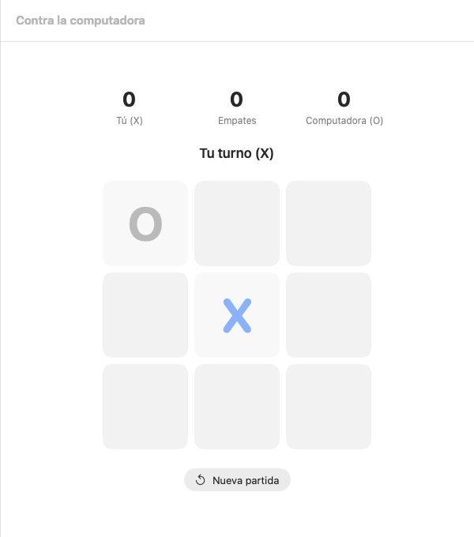
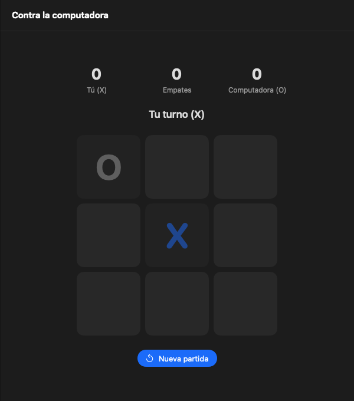
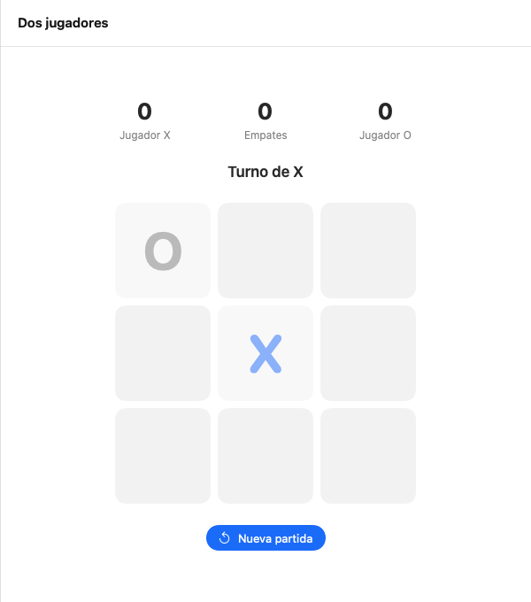
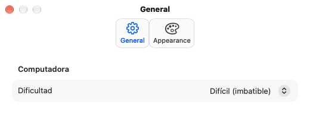

# Gato

El clásico juego del gato (tic-tac-toe) como app nativa de macOS, hecha con SwiftUI. Funciona sin servidor ni base de datos.

| Claro | Oscuro |
| --- | --- |
|  |  |

## Características

- **Contra la computadora**: juegas con X. Dificultad *Fácil* o *Difícil* (imbatible, usa minimax).
- **Dos jugadores**: X y O en el mismo Mac.
- Marcador de victorias y empates por modo; el jugador que empieza se alterna en cada partida.
- La línea ganadora se resalta.
- Modo claro y oscuro, y color de acento a elección en Ajustes.

| Dos jugadores | Ajustes |
| --- | --- |
|  |  |

## Atajos

| Atajo | Acción |
| --- | --- |
| ⌘N | Nueva partida |
| ⌘R | Reiniciar marcador |
| ⌘, | Ajustes |

## Requisitos

- macOS 26 o posterior
- Swift 6.2 o posterior (Xcode instalado)

## Compilar y ejecutar

```bash
./build.sh --open     # compila, firma e instala en ~/Applications/Gato.app
```

## Pruebas

```bash
swift test --scratch-path ~/Library/Developer/Gato/test-build   # lógica del juego
tools/selftest.sh                                               # autoprueba de la app
tools/snap.sh                                                   # capturas en /tmp/Gato-shots
```

## Estructura

- `Sources/GatoKit/` reglas del juego y la IA (sin SwiftUI), con tests en `Tests/GatoKitTests/`.
- `Sources/Gato/` interfaz, ajustes y estado de la app.
- `docs/screenshots/` capturas usadas en este README.
